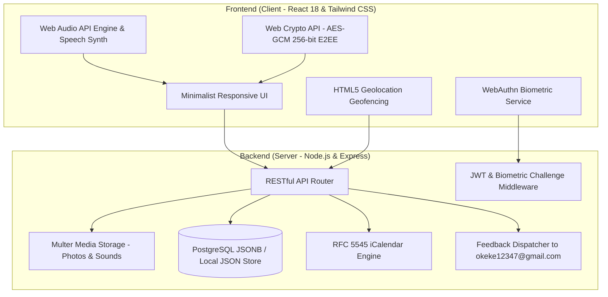

# ⏰ AuraAlarm | Next-Gen Smart Alarm, Sleep Aid & Wellness Suite

> **A minimalist, full-stack React and Node.js platform designed for millions of users.** Features personalized wake-up photos of loved ones, dynamic time greetings, synthesized sleep aid audio, WebAuthn biometric security, end-to-end encrypted notes (AES-256-GCM), location-based geofence reminders, iCalendar (.ics) exports, daily streaks with social sharing, and circadian fitness & nutrition tracking.

---

## 🌟 Key Features

### 1. 🌙 Fall Asleep Soundscapes
- Real-time synthesized ambient audio using the **Web Audio API** (zero missing asset risk, 100% offline-ready):
  - **Rain on Skylight** (Pink noise filter with random droplet impulse nodes)
  - **Pacific Deep Tide** (Sweeping lowpass wave cycles)
  - **Theta Wave Restoration (6Hz)** (Binaural harmonic brainwave entrainment)
  - **Aura Brown Noise** (Deep acoustic masking)
  - **Twilight Campfire** (Ambient crackle and forest breeze)
  - **Zen Sanctuary Stream** (Meditative mountain spring harmonics)
- **Sleep Timer**: 15m, 30m, 45m, 60m, 90m with gentle volume fade-out.
- **Dr. Weil's 4-7-8 Deep Sleep Breathing Guide**: Animated visual breathing pacer for parasympathetic nervous system activation.

### 2. 🌅 Personalized Alarm Ringing Screen
- **Photo Customization**: Users can upload or select high-resolution portraits of their partner, family member, or inspiration to display prominently when the alarm triggers.
- **Dynamic Time Greeting**: Automatically detects the exact time and greets the user with:
  - *"Good morning"* (4:00 AM – 11:59 AM)
  - *"Good afternoon"* (12:00 PM – 4:59 PM)
  - *"Good evening"* (5:00 PM – 3:59 AM)
- **Web Speech API Spoken Voice Greeting**: Natural synthesized voice delivers the personalized greeting and message.
- **Personal Media Sync**: Upload custom audio tones (MP3, WAV, OGG) or select from built-in pentatonic dawn chimes and temple bells.
- **Snooze (+5m)** and **Dismiss & Rise** (triggers celebratory confetti, updates streak, logs awake timestamp, and pings loved one).

### 3. 🔐 Simple & Secure Biometric Login (WebAuthn / Passkeys)
- Native biometric authentication via **WebAuthn API** (Touch ID, Face ID, Windows Hello, Android Biometric Prompt).
- Seamless fallback credential support for cross-device authentication.
- **End-to-End Encryption (E2EE)**: Sensitive notes, destination memos, and health data are encrypted client-side using **AES-256-GCM** via the Web Crypto API before sync.

### 4. ❤️ Loved One Peace of Mind & Safety Tracking
- Configure loved one's photo, name, contact details, and custom wake message.
- **Automated Peace-of-Mind Notification**: Automatically dispatches a safe check-in notification when the alarm is dismissed.
- **Location Badge**: Option to share a verified safe zone badge (e.g., *"Central Residence - Safe Zone"*).
- **Public Companion Portal Link**: Generate a unique link for partners to bookmark on their phone to verify their loved one is awake and safe.

### 5. 📍 Location-Based Reminders & External Calendar Export
- **Geofence Reminders**: Set arrival or departure alerts for specific destinations (e.g. gym, office, home).
- **HTML5 Geolocation API**: 1-click GPS auto-detection with custom radius slider (50m to 1,000m).
- **Universal iCalendar (.ics) Export**: 1-click export of alarms, recurring habits, and location alerts compliant with RFC 5545 for **Google Calendar**, **Apple Calendar**, and **Microsoft Outlook**.

### 6. 🏃 Fitness Industry Leadership: Personalized Workouts & Fuel
- **Circadian Workout Library**:
  - *Sunrise Energy & Joint Mobility* (10 min wake-up mobility routine)
  - *Metabolic Dawn Spark HIIT* (15 min fat oxidation & dopamine ignition)
  - *Twilight Restorative Decompression* (12 min sleep preparation stretch)
- **Interactive Workout Player**: Real-time interval timers, countdown rings, and form coaching cues.
- **Metabolic Fuel & Hydration Tracking**: Interactive water glass counter (250ml intervals) with milestone alert triggers at 10:00 AM and 2:30 PM.

### 7. 📊 Historical Dashboard, Gamification & Social Sharing
- **Historical Metrics**: 7-day wake consistency score (%), average sleep duration, total wake sessions.
- **Gamification Engine**: Daily streaks, level progression (*"Master of Dawn"*), and unlockable badges (*Dawn Chaser*, *Deep Rest Master*, *Vitality Champion*, *Guardian of Peace*).
- **Social Sharing**: 1-click generator for visually stunning social media cards shareable directly to X (Twitter), WhatsApp, or clipboard.

### 8. 💬 Direct Feedback & Support
- Dedicated in-app inquiry modal directly connected to lead developer at:
  - **okeke12347@gmail.com**
- Generates tracking tickets and provides a pre-formatted 1-click mailto launcher.

### 9. 👑 Direct Storeless Monetization & VIP Membership
- **100% Retained Revenue (Zero Google/Apple 30% cuts)**:
  - **Aura Pro Monthly**: $3.99 / ₦3,000 per month (Individual Circadian & Sleep Master).
  - **Aura Duo Couples Pass**: $5.99 / ₦4,500 per month (2 Linked Accounts with automated SMS/WhatsApp morning companion wake alerts).
  - **Founder Lifetime VIP**: $49.00 / ₦40,000 one-time (Pay once, own forever with golden founder badge).
- **Multi-Currency & Multi-Gateway**:
  - Live currency switch: USD ($) & NGN (₦).
  - Supports Card (Paystack/Stripe), Direct Bank Wire & USSD, and 1-Click Instant Test Sandbox for testing and demoing live.
  - Activates exclusive VIP soundscapes: **528Hz Miracle Solfeggio**, **2.5Hz Pineal Delta Dream**, and **Celestial Nebula Drift**.

### 10. 🎁 Referral Rewards
- Every account gets a unique invite link; new accounts created through the link are attributed to the inviter.
- Earn ₦2,000 for 10 invited account registrations within a rolling 24-hour window, or ₦5,000 when 5 invited accounts have an active paid subscription.
- Sign in to request an earned reward. Payouts are arranged manually, and the public payment history lists only rewards an admin has marked paid after sending them.
- Public payment entries use masked names and do not expose payout details.

---

## 🛠️ Architecture & Tech Stack



- **Frontend**: React 18, Vite 5, Tailwind CSS, Lucide Icons, Canvas Confetti.
- **Audio Engine**: Web Audio API (Oscillators, BiquadFilters, ChannelMerger, BufferSources).
- **Speech Engine**: Web Speech API (`SpeechSynthesisUtterance`).
- **Security**: WebAuthn standard (`PublicKeyCredential`), Web Crypto API (`SubtleCrypto` AES-GCM 256-bit, PBKDF2), JWT.
- **Backend**: Node.js, Express, Multer, Bcrypt, UUID.

---

## 🚀 Quick Start Guide

### Prerequisites
- Node.js v18+ (tested on Node v24)
- npm v9+

### Subscription Access & Payment Configuration
Visitors can explore the app in a read-only preview before subscribing. The preview uses sample data; account data and protected API features require an account with an active subscription. New accounts and submitted bank-transfer proofs do not get paid access until payment is verified. The server checks subscription status for protected API requests.

Before deploying, configure these environment variables:
- `DATABASE_URL`: PostgreSQL connection string. Required in production; leave unset locally to use `server/data/database.json`.
- `JWT_SECRET`: a unique secret of at least 32 random bytes. Required when `NODE_ENV=production`.
- `ADMIN_EMAIL`: the account email allowed to review and approve payment proofs.
- `PAYSTACK_SECRET_KEY`: optional; required for server-side card-payment verification.
- `VITE_PAYSTACK_PUBLIC_KEY`: optional; set when building the client to enable Paystack checkout.
- `SMTP_HOST`, `SMTP_PORT`, `SMTP_USER`, `SMTP_PASS`: SMTP credentials required to deliver password-reset emails. Keep the password private and configure these in the Render service environment, not in source control.
- `SMTP_FROM`: optional sender address; defaults to `SMTP_USER`.
- `PUBLIC_APP_URL`: public website URL used in password-reset links; defaults to `https://auraalarm.onrender.com`.

The Neon CLI stores local connection variables in the root `.env.local`; the server start scripts load that file and `server/.env` without printing their values. Keep both files out of source control.

If Paystack is not configured, customers can submit bank-transfer proofs for manual review. An authorized admin must confirm the money actually arrived in the Fidelity account before approving; uploaded receipts and reference-number format checks are not bank verification. The app does not currently have a Fidelity Bank API/webhook integration, so Fidelity itself does not approve or reject transfers through this app. A direct bank integration requires official Fidelity business/API access, documentation, and credentials. Do not put the Paystack secret key in the client or expose it in browser code.

### 1. Installation
Install dependencies for both client and server:
```bash
npm run install:all
```

### 2. Development Mode
To run both backend API and Vite client with Hot Module Reload:

**Terminal 1 (Backend Server - Port 5000):**
```bash
cd server
npm start
```

**Terminal 2 (Frontend Client - Port 5173):**
```bash
cd client
npm run dev
```

### 3. Production Self-Contained Mode
The server is configured to serve both the REST API and the optimized production frontend build simultaneously on port `5000`:
```bash
cd client
npm run build
cd ../server
npm start
```
Then visit: `http://localhost:5000`

### 4. Hosted preview without Google Cloud billing
The repository includes a Render Blueprint in `render.yaml` for the full Express server and built React client. It expects a PostgreSQL connection string and a production JWT secret to be supplied through the hosting dashboard; do not commit either value.

For a no-card database option, create a [Neon](https://neon.com/) free project and use its pooled connection string as `DATABASE_URL`. The first server startup creates an empty database state; local `server/data/database.json` is intentionally not copied to the hosted database. Demo accounts and sample server records are not seeded in production.

The current PostgreSQL adapter stores the app's collections in one JSONB state row and is intended for a single-instance preview, not a scaled production service. Render free services sleep when idle and have an ephemeral filesystem. Uploaded photos, sounds, and receipts therefore are not persistent yet; object storage must be added before relying on uploaded files.

To deploy, create a private Git repository after checking that `.env` files, `server/data/`, and `server/uploads/` are excluded. In [Render](https://render.com), create a Blueprint from that repository and provide `DATABASE_URL` and a newly generated `JWT_SECRET` when prompted. The service builds `client/dist` and serves the API and frontend from the same HTTPS URL.

### Install on a Phone
Use the browser's **Install app** or **Add to Home Screen** option on the deployed HTTPS website. Direct APK downloads are disabled until a signed, verified Android release is available; this avoids asking visitors to install an unsigned or unverified package.

---

## 🧪 Testing the Live Alarm Ringing Screen

1. Open `http://localhost:5000` in your browser.
2. Under the **Alarms** tab, click the **Play (▶)** button on any alarm card (or click **Test Preview**).
3. The fullscreen alarm screen will trigger:
   - Displays the customized photo of the loved one.
   - Computes the time-based greeting (*"Good morning", "Good afternoon", or "Good evening"*).
   - Natural spoken speech greeting announces the loved one's morning message.
   - Synthesizes soothing alarm audio.
   - Click **Dismiss & Rise** to celebrate with confetti, increment daily streak, and log a peace-of-mind check-in!

---

## 📩 Support & Inquiries
- **Lead Developer**: [okeke12347@gmail.com](mailto:okeke12347@gmail.com)
- **License**: MIT
